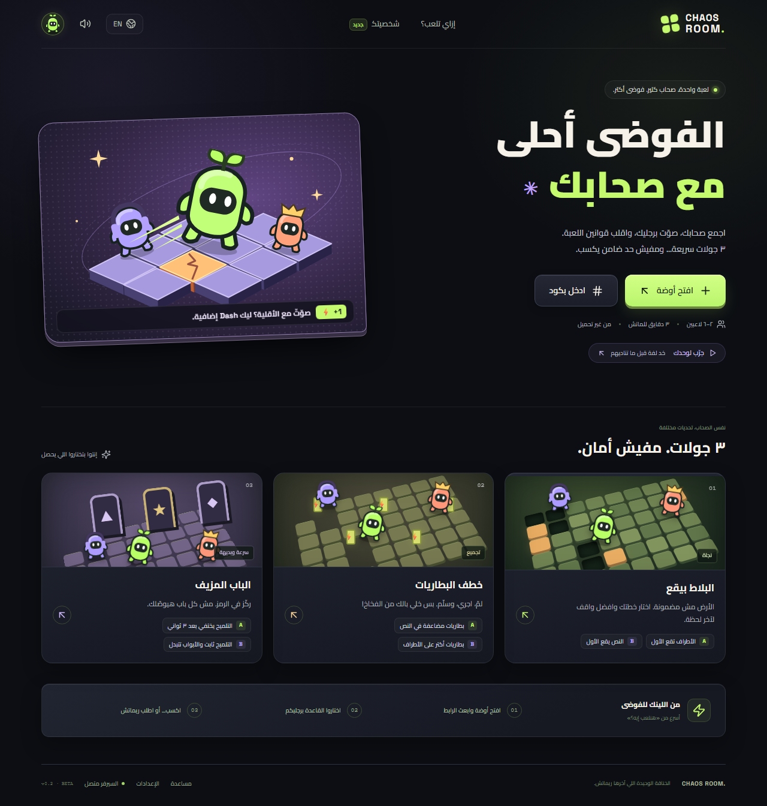
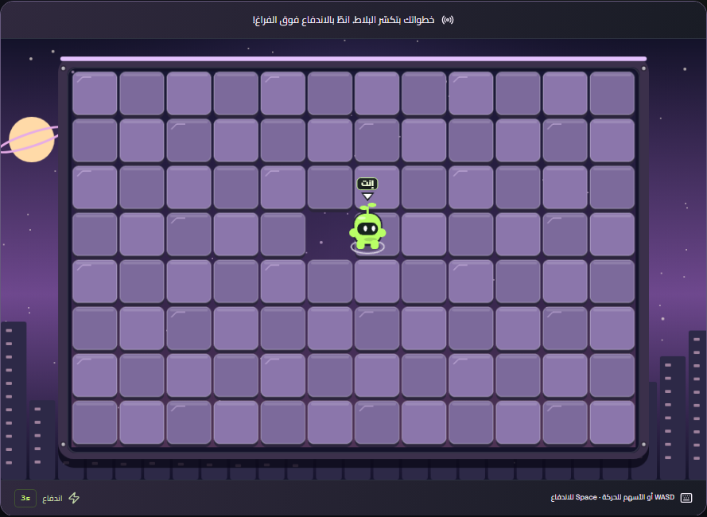
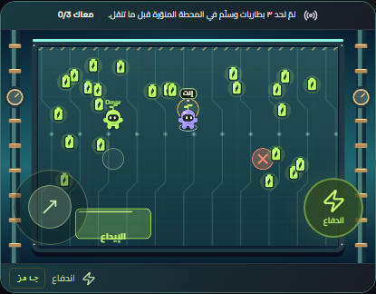
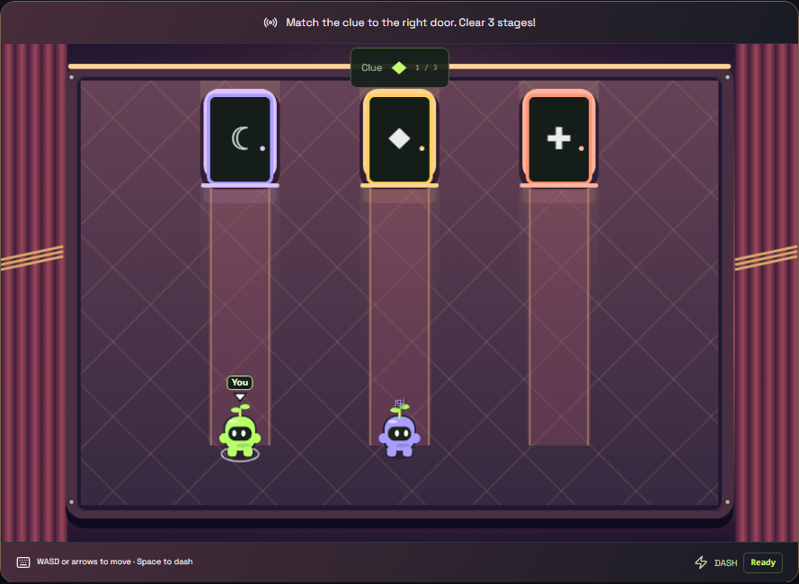
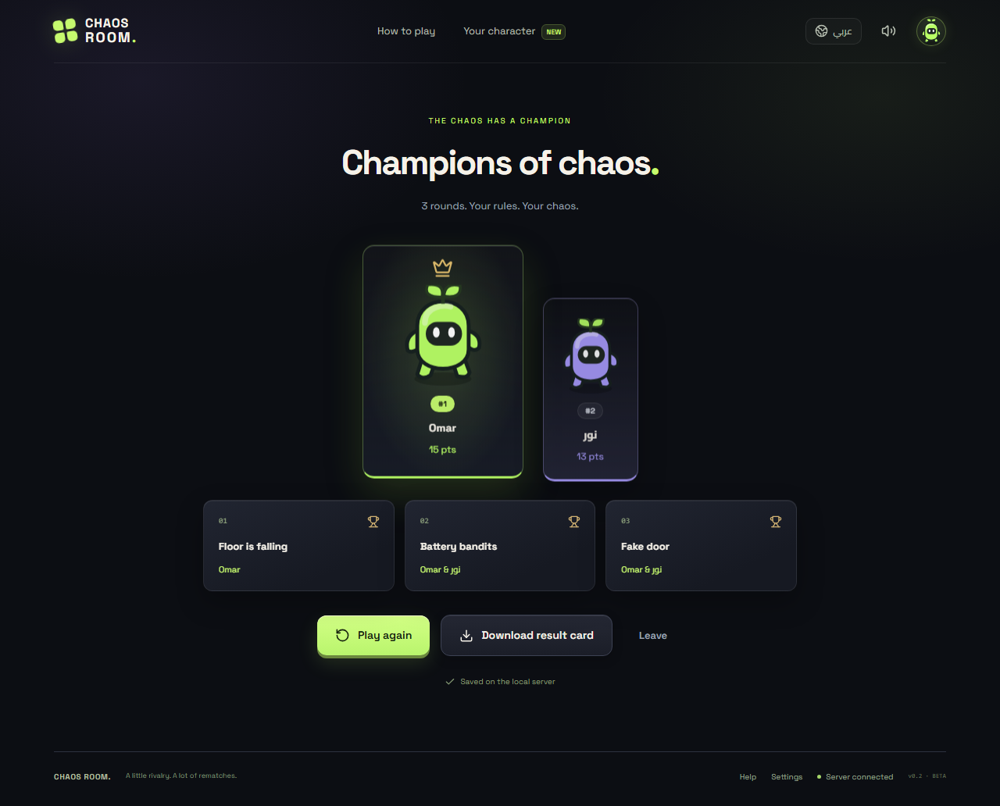

# CHAOS ROOM · أوضة الفوضى

A browser party game for 2–6 friends. Move to vote on the next rule; the losing voters earn one extra dash. Arabic first, with English throughout. Three server-authoritative games: falling tiles, battery collection, and symbol doors.



## Screenshots

| Falling Tiles (`البلاط بيقع`) | Battery Bandits (`خطف البطاريات`) |
| :---: | :---: |
|  |  |

| Fake Door (`الباب المزيف`) | Champions Podium (`أبطال الفوضى`) |
| :---: | :---: |
|  |  |

## Run locally

Requires Node.js 22.18+ and npm. From the repository root:

```powershell
npm ci
npm run dev
```

Open **http://localhost:3000**. The game server listens on **http://localhost:4000**. Create a room, then open its invite in a separate browser profile/private window to join as another guest. Tabs in the same profile share one identity; opening a second tab transfers that guest's connection.

### Run with real local MongoDB (Beta 0.2)

If `mongod` is installed and available on PATH:

```powershell
npm run dev:db
```

This starts a project-owned database bound to `127.0.0.1:27018` and then starts both apps. It never opens an installed system database or changes a MongoDB Windows service. Data lives in the ignored `.local-data/mongo-dev` directory. A random development session secret is stored locally so guest cookies remain valid between runs. Live game rooms still live in process memory and are not restored after restart. Stop with Ctrl+C. Set `MONGODB_BINARY` to your `mongod` executable or `DEV_MONGO_PORT` to an unused local port if needed.

Use the normal `npm run dev` command when you want the original file-storage fallback instead.

No credentials are needed for local play. Development results are written to `apps/server/.local-data/matches.ndjson`, and issue reports to `feedback.ndjson`. The UI explicitly identifies local persistence. Production refuses to start without MongoDB, an HTTPS web origin, and a session secret. Guest sessions survive a development server restart only when you configure a stable `SESSION_SECRET`.

To configure services, copy each app's `.env.example` to `.env` (server) or `.env.local` (web), fill the values, and restart. Keep secrets out of source control. `NEXT_PUBLIC_SERVER_URL` is a **build-time public** setting, never a secret.

## What works

- Arabic/English home, nickname entry, private room invite, lobby, readiness, host controls, 2–6 players, and solo practice.
- Phaser arena, eight-direction movement, keyboard and multitouch controls, local prediction, reconciliation, and remote interpolation.
- Eight-second positional voting, neutral abstention zone, seeded tie resolution, a normal dash and one minority bonus.
- Falling tiles, battery pickup/deposit/traps, and three-stage symbol doors, followed by competition-rank scoring and rematch.
- Signed HttpOnly guest sessions, duplicate-command protection, reconnect snapshots, 20-second reservation, host transfer, mid-match waiting, and room capacity limits.
- Cosmetics preview, persistent local preferences, sound, optional music, reduced motion, emoji mute, factual SVG result cards, and issue reports.
- MongoDB result upserts and optional Google account linking with state, PKCE, nonce, signature and audience checks. OAuth needs real credentials to run.
- Admin page at `/admin`, authenticated server metrics, match admission pause and room cancellation.

Purchasing is deliberately disabled. All preview skins are free and do not change hitboxes. No payment provider, purchase endpoint, currency, public matchmaking, chat, or rankings are enabled.

## Commands

```powershell
npm run typecheck
npm test
npm run test:mongo
npm run build
npm run test:e2e
npm run test:load
```

The web production build uses Webpack because Turbopack's CSS worker failed in the initial Windows environment. Development uses Turbopack. The lockfile pins the resolved dependencies; use `npm ci` for repeatable installs.

Run typecheck and build sequentially: Next.js regenerates files under `.next/types` during a build.

`test:mongo` starts an isolated temporary MongoDB process, verifies real persistence, concurrent writes, account linking races, restart/session continuity and outage recovery, then removes only its own test directory. It requires `mongod` (or `MONGODB_BINARY`). CI uses its isolated MongoDB service through `MONGO_TEST_ORIGIN`; only loopback origins without a database name are accepted, and a unique disposable test database is created. These tests do not contact Google or claim to validate real Google consent or credentials.

Before production provisioning, run `npm run check:deploy`. It checks server `.env`, web `.env.local`, or supplied environment variables, reports missing/invalid keys without printing secret values, and exits with a nonzero status when configuration is incomplete. It checks configuration format; provider access and same-site domain setup still require staging verification.

Playwright uses two separate browser contexts to finish a complete match, verify persisted results, download a share card, and rematch. A second test checks mobile sizing, language persistence, settings, and the unconfigured-account state. Install its browser once with `npx playwright install chromium` if needed. Failure traces/screenshots are saved in `test-results/`.

Load testing starts an isolated local server unless `LOAD_URL` is supplied. Defaults: 10 rooms × 6 clients for 60 seconds. It reports connected clients, snapshots, command acknowledgment p95, event-loop p95, and process memory. To run the release endurance scenario in PowerShell:

```powershell
$env:LOAD_SECONDS='3600'
npm run test:load
```

For 20 rooms / 120 clients, also set `LOAD_ROOMS=20`; adjust per-IP connection limits on isolated staging if simulating all players from one machine. A local load test does not measure real mobile rendering or internet latency.

## Architecture

- `apps/web`: Next.js, React, Tailwind, Phaser, Socket.IO client. Rendering is separate from game decisions.
- `apps/server`: Express, Socket.IO, authoritative 30 Hz simulation / 15 Hz snapshots, Mongoose persistence and Google OIDC.
- `packages/shared`: protocol, Zod validation, maps, movement, voting and scoring helpers shared by both apps.

See [game rules](docs/GAME_DESIGN.md), [network contract](docs/PROTOCOL.md), [deployment and operations](docs/OPERATIONS.md), [release gates](docs/RELEASE.md), and [asset provenance](docs/ASSETS.md).

## Production status

This is a runnable implementation for local/staging testing, **not a claim that the public-launch gates have been met**. Before opening publicly: connect and test real MongoDB and Google credentials, configure same-site HTTPS domains, run the hour-long staging load tests, test real Android/iOS devices on different networks, review public privacy/support text, and complete the independent playtests in `docs/RELEASE.md`. No cloud accounts or paid infrastructure were provisioned by this repository setup.
